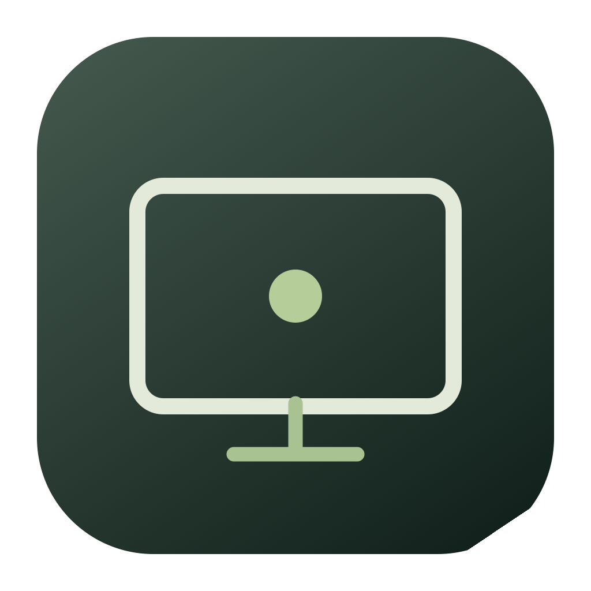

<p align="center"></p>

# Quiet Desktop

A calm, minimal desktop companion for macOS and Windows. Keep your favorite apps, a personal photo, and a little space for notes within reach.

## Download

| Platform | Download | Requirements |
| --- | --- | --- |
| Windows | [Windows x64 ZIP, version 1.6.0](https://github.com/nawenxuanli/quiet-desktop/releases/tag/v1.6.0) | Windows 10 version 2004 or later / Windows 11, x64 |
| macOS | [Mac ZIP, version 1.5.0](https://github.com/nawenxuanli/quiet-desktop/releases/tag/v1.5.0) | Apple silicon (M1 or newer), macOS 14+ |

For Windows, extract the entire ZIP and open QuietDesktop.exe. Read [WINDOWS.md](WINDOWS.md) for features, shortcuts, build instructions, and Microsoft Store packaging. The Windows runner has passed compilation, native window rendering, settings round-trip, and crop-boundary checks. Microsoft Store certification is a separate step and has not been completed.

For macOS, unzip the download, drag Quiet Desktop.app into Applications, and open it. The Mac build is ad-hoc signed and not Apple-notarized. Standalone Windows downloads are not Authenticode-signed. Your operating system may require you to review the app before opening it; keep system security protections enabled.

The remaining usage and build instructions below describe the macOS edition. Windows instructions are in WINDOWS.md.

## Features

- Large clock, date, and System, Light, and Dark appearance choices. System follows macOS automatic appearance changes.
- App search: press **Command K**, type an app name, then press Return.
- **Within Reach:** click **Edit** to add, remove, or reorder favorite apps.
- A photo panel: choose from Photos or an image file.
- Rounded, edge-to-edge photos with a **Crop** preview, zoom, and position controls.
- Notes that save automatically on your Mac.
- Finder shortcuts for Home, Documents, Downloads, and Desktop.
- Full-screen mode, with quick access back to your usual desktop.

## Everyday use

| Action | Control |
| --- | --- |
| Search applications | Command K |
| Show your other windows | Command H |
| Toggle full screen | Control Command F |
| Quit | Command Q |
| Customize favorite apps | Edit beside Within Reach, then Save |
| Adjust your photo | Crop, adjust sliders, then Save |
| Restore the centered photo crop | Reset in the crop panel |

Quiet Desktop runs alongside Finder and your normal apps. It does not replace macOS, change your Dock, or enable itself at login. To launch it automatically, add it in System Settings → General → Login Items.

## Build from source

Install Xcode or the Xcode command line tools, then run:

```sh
sh build.sh
open 'build/Quiet Desktop.app'
```

The build script compiles for the current Mac architecture and packages the included icon. Only the Apple silicon build has been verified. No third-party dependencies are required.

## Local data and privacy

Notes, favorite app paths, appearance, a resized copy of your selected photo, and its crop settings are stored in this app's local preferences. They are not included in this repository or release. Data is not encrypted by the app. The app makes no direct network requests; Photos may download a selected iCloud image, and applications you launch use their normal connections.

Choosing a new photo resets its crop. Cropping changes the display only; the original image file stays unchanged.

## Validation and limitations

The native app and included build script were compiled successfully, and their app code signatures were checked. Manual checks covered launch, app search, appearance switching, favorite app editing and persistence, image file selection and persistence, and the photo crop preview and controls. Photos-library selection still needs verification with a populated Photos library. This is an early release, with no automatic updater.

App discovery checks standard application folders. Apps stored elsewhere or installed while Quiet Desktop is running may require moving them into Applications and restarting the app.

## Feedback

Report bugs or request features through [GitHub Issues](https://github.com/nawenxuanli/quiet-desktop/issues). Include your macOS version and what happened; omit personal photos, notes, or other private information.

## License

No open-source license has been selected for this project. Public availability does not grant additional permission to redistribute or reuse its code or artwork.
